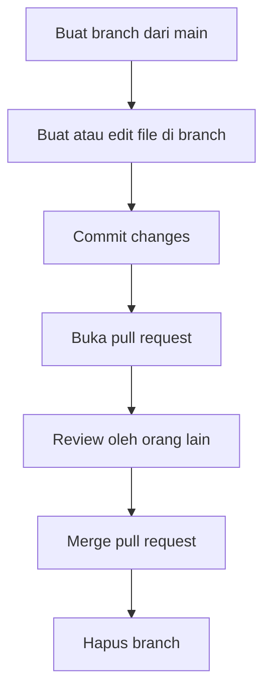

# GitHub Notes

Catatan dari exercise GitHub Skills: Introduction to GitHub.
Semua langkah di exercise ini dikerjakan di browser, bukan di terminal.
Untuk command Git di terminal, lihat `git-notes.md`.

## 1. Git dan GitHub

| | Git | GitHub |
|---|---|---|
| Jenis | Tool version control di komputer | Platform web yang memakai Git |
| Fungsi | Catat perubahan, buat branch, merge | Simpan repository online, kolaborasi, pull request |

## 2. Istilah baru

| Istilah | Arti |
|---|---|
| Pull request (PR) | Usulan agar perubahan di satu branch digabung ke branch lain. Orang lain bisa menerima, menolak, atau memberi saran |
| Base | Branch tujuan PR (di exercise: `main`) |
| Compare | Branch yang berisi perubahan kamu (di exercise: `my-first-branch`) |
| Profile README | Bagian "About me" di halaman profil GitHub. Dibuat dari repository publik dengan nama sama seperti username |
| Markdown (`.md`) | Format teks dengan simbol sederhana untuk judul, daftar, dan tabel |

## 3. Alur kerja di GitHub

## 4. Langkah di web

### Buat branch
1. Buka tab **Code** di repository.
2. Klik dropdown branch (**main**).
3. Ketik nama branch di kolom **Find or create a branch...**
4. Klik **Create branch: nama from main**.

Branch baru langsung menjadi branch aktif.

### Buat file dan commit
1. Pastikan kamu ada di branch yang benar.
2. **Add file** > **Create new file**.
3. Isi nama file dan isi konten.
4. Klik **Commit changes...**
5. Tulis commit message, lalu klik **Commit changes**.

Contoh pesan dari exercise: `Add PROFILE.md`.

### Buka pull request
Cara cepat: klik tombol **Compare & pull request** yang muncul setelah commit.

Cara manual:
1. Tab **Pull requests** > **New pull request**.
2. Pilih **base** dan **compare**.
3. Klik **Create pull request**.
4. Isi judul dan deskripsi, lalu klik **Create pull request** lagi.

Deskripsi PR menjelaskan apa yang berubah dan kenapa.

### Merge pull request
1. Klik **Merge pull request**, lalu **Confirm merge**.
2. Klik **Delete branch** (branch sudah tidak dipakai).

Kalau tombol merge abu-abu, tunggu workflow selesai berjalan.
Merge juga membuat satu commit, sama seperti commit biasa.

## 5. Padanan di Git CLI

Bagian ini tambahan saya sendiri, bukan dari exercise.

| Di web GitHub | Padanan di terminal |
|---|---|
| Create branch | `git switch --create my-first-branch` |
| Create new file + Commit changes | `git add PROFILE.md` lalu `git commit -m "Add PROFILE.md"` |
| (otomatis saat commit di web) | `git push origin my-first-branch` |
| Create pull request | Tidak ada di Git. Fitur GitHub |
| Merge pull request | `git merge` (di GitHub berjalan di server) |
| Delete branch | `git branch --delete my-first-branch` |

Di web, commit langsung masuk ke GitHub. Di terminal, commit tetap lokal sampai kamu `git push`.

## 6. Setelah selesai: Profile README

1. Buat repository publik dengan nama sama persis seperti username GitHub.
2. Buat file `README.md` di root repository (bukan di dalam folder).
3. Isi file itu dengan perkenalan diri.
4. Kalau kerja di branch baru, buka dan merge pull request.
